# 3ra Entrega: Procesos de negocio de BecoGre

Borrador. Los procesos describen cómo funciona la organización, sin software. El sistema aparece recién en los casos de uso, que son la automatización de cada proceso.

Todas las figuras están en [docs/diagramas](diagramas/) en formato SVG.

## Figuras generales

- Diagrama de clases general (capa de negocio): [class_general.svg](diagramas/class_general.svg)
- Modelo de datos general (DER): [der_general.svg](diagramas/der_general.svg)

## Resumen

| Código | Proceso | Naturaleza | Gestiones de G02 que cubre |
|---|---|---|---|
| N01 | Gestión de la red de puntos verdes y de las tarifas | Apoyo a la toma de decisiones | G02.5, G02.8, G02.9 |
| N02 | Venta de productos sustentables y cobro de comisión | Ingreso | G02.7, G02.8 |
| N03 | Reconocimiento por reciclaje y canje de Eco-Puntos | Egreso | G02.2, G02.3, G02.9 |

Casos de uso (numeración global):

| Caso de uso | Proceso | Descripción breve |
|---|---|---|
| CU01 | N03 | Declarar material y recibir recomendación (existente, reformulado) |
| CU02 | N03 | Registrar recepción de material en punto verde (extiende a CU01) |
| CU03 | N03 | Canjear Eco-Puntos por cupón o envío bonificado |
| CU04 | N01 | Consultar indicadores de acopio y ventas |
| CU05 | N01 | Administrar puntos verdes y materiales |
| CU06 | N01 | Configurar comisiones y tabla de conversión de Eco-Puntos |
| CU07 | N02 | Verificar identidad del vendedor (incluido en CU08) |
| CU08 | N02 | Publicar producto en el marketplace |
| CU09 | N02 | Comprar y pagar pedido |
| CU10 | N02 | Confirmar recepción y liquidar saldo al vendedor |
| CU11 | N02 | Gestionar reclamo de pedido (extiende a CU10) |

---

## N01. Gestión de la red de puntos verdes y de las tarifas

**Naturaleza:** apoyo a la toma de decisiones.

### 1. Roles intervinientes

- **Gerencia:** analiza la información disponible y decide altas y bajas de puntos verdes, materiales aceptados y tarifas.
- **Referente de cooperativas y puntos verdes:** aporta el conocimiento de campo y valida los datos de las locaciones.
- **Área comercial:** aporta datos de ventas, comisiones cobradas y productos publicados.

### 2. Descripción funcional del proceso

- **Entrada:** informes de acopio por material y zona, informes de ventas y canjes, solicitudes de nuevos puntos verdes o de cambio de tarifas.
- **Comportamiento:** una vez por mes, la gerencia revisa el acopio por material y zona, el volumen de ventas y el costo de los canjes. Con esa información evalúa si conviene incorporar o dar de baja un punto verde, habilitar o deshabilitar materiales, o ajustar la comisión por categoría y la tabla de conversión de Eco-Puntos. El referente de cooperativas valida las locaciones propuestas. Las decisiones se formalizan y se comunican a las áreas involucradas.
- **Salida:** decisiones formalizadas sobre la red de puntos verdes y las tarifas vigentes.

### 3. Diagrama de actividad

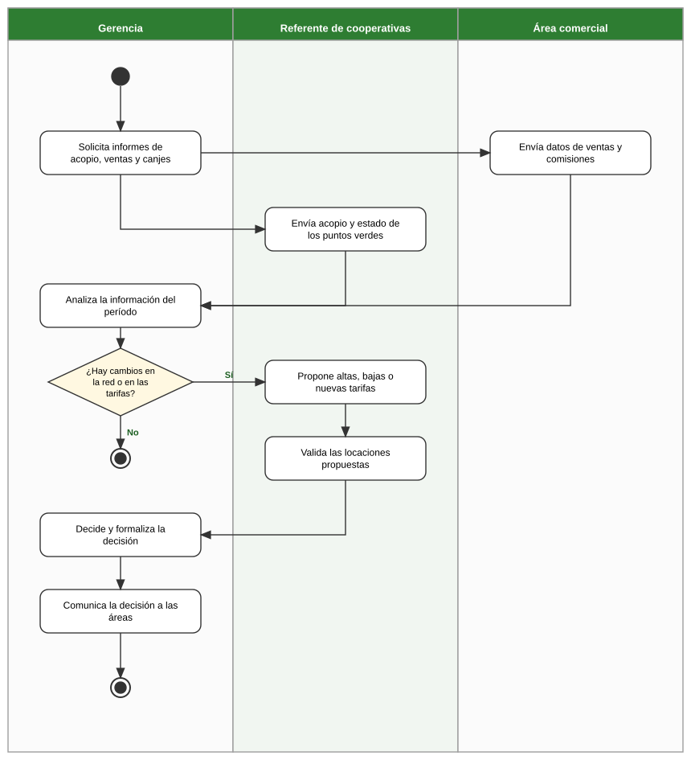

### 4. Modelo conceptual

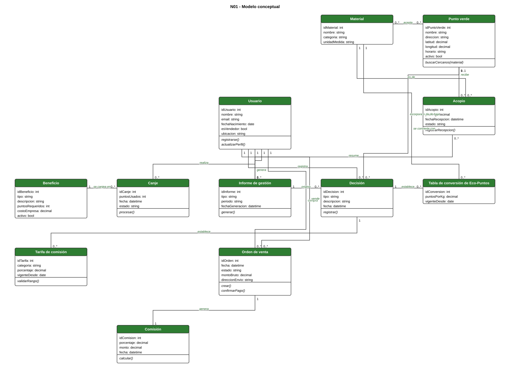

### 5. Especificación de casos de uso

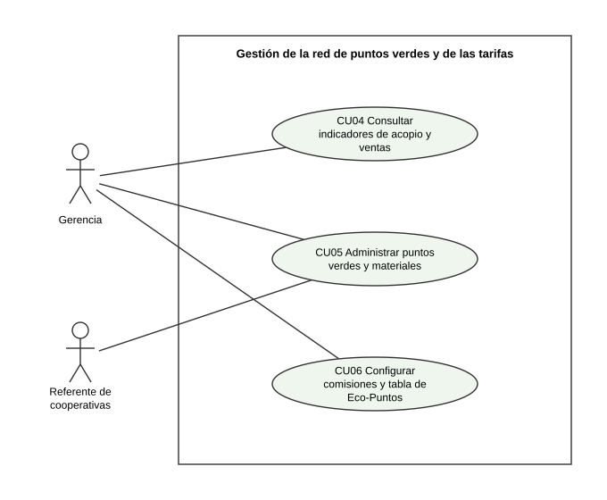

**CU04. Consultar indicadores de acopio y ventas**

| Ítem | Detalle |
|---|---|
| Objetivo | Que la gerencia cuente con datos para decidir sobre la red y las tarifas. |
| Actor principal | Gerencia. |
| Disparador | Inicio del ciclo mensual de revisión. |
| Precondiciones | Existen registros de acopio, ventas y canjes del período. |
| Escenario principal | 1. La gerencia selecciona el período. 2. El sistema obtiene ventas, acopio y canjes del período. 3. El sistema muestra indicadores por material y zona. 4. La gerencia configura tarifas (CU06) si corresponde. |
| Flujos alternativos | 2a. Sin datos en el período: el sistema lo informa. |
| Postcondiciones | Los indicadores quedan disponibles para la decisión. |

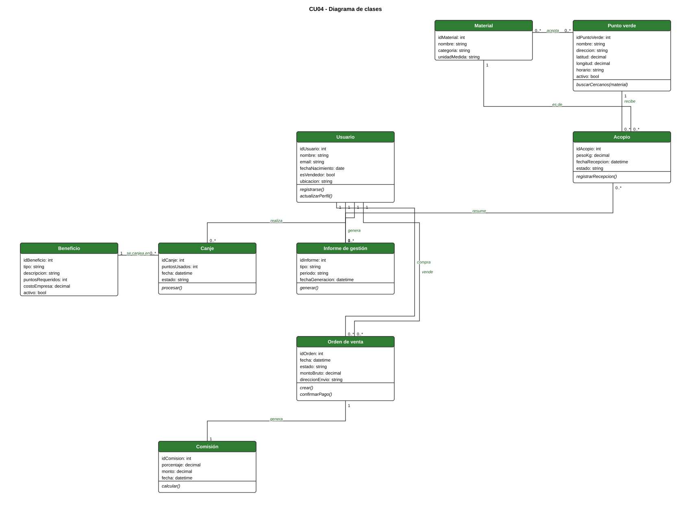
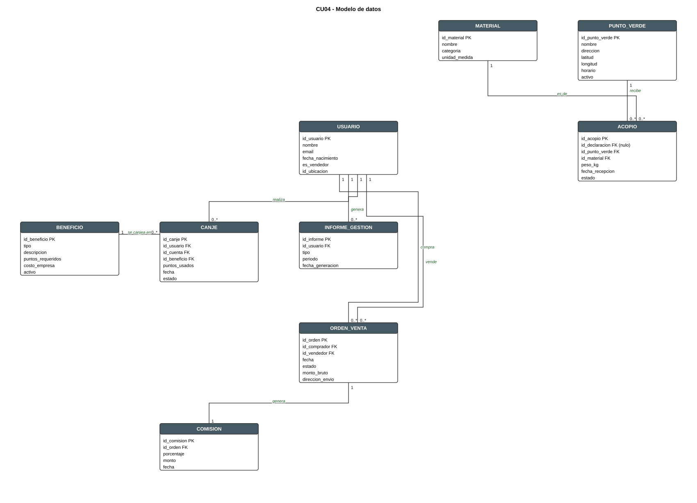
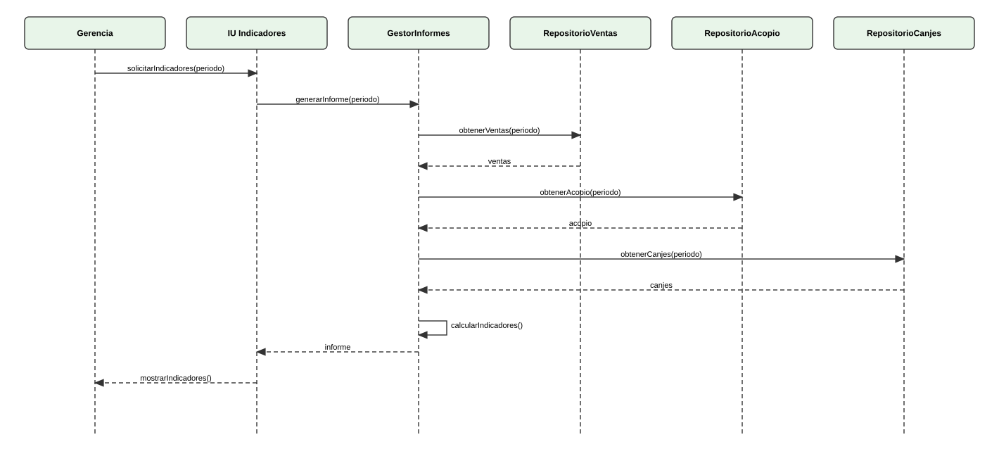

**CU05. Administrar puntos verdes y materiales**

| Ítem | Detalle |
|---|---|
| Objetivo | Mantener actualizado el catálogo de puntos verdes y de materiales aceptados. |
| Actores | Gerencia (decide), Referente de cooperativas (valida). |
| Disparador | Decisión de alta, baja o cambio de un punto verde o de un material. |
| Precondiciones | Existe una propuesta validada por el referente. |
| Escenario principal | 1. La gerencia registra la propuesta de alta, baja o modificación. 2. El referente valida los datos de la locación. 3. La gerencia confirma el cambio. 4. El sistema actualiza el catálogo. |
| Flujos alternativos | 2a. Datos no validados: el cambio queda pendiente. |
| Postcondiciones | El catálogo refleja la decisión vigente. |

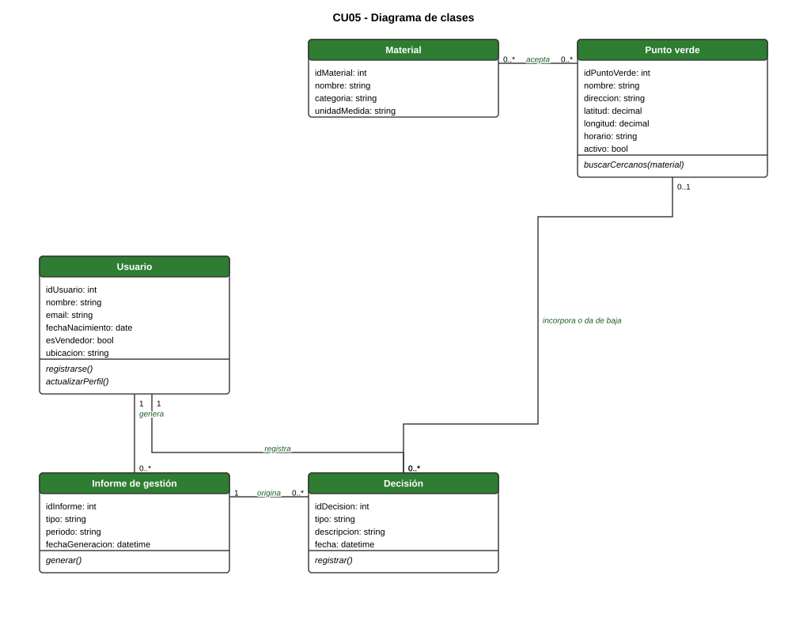
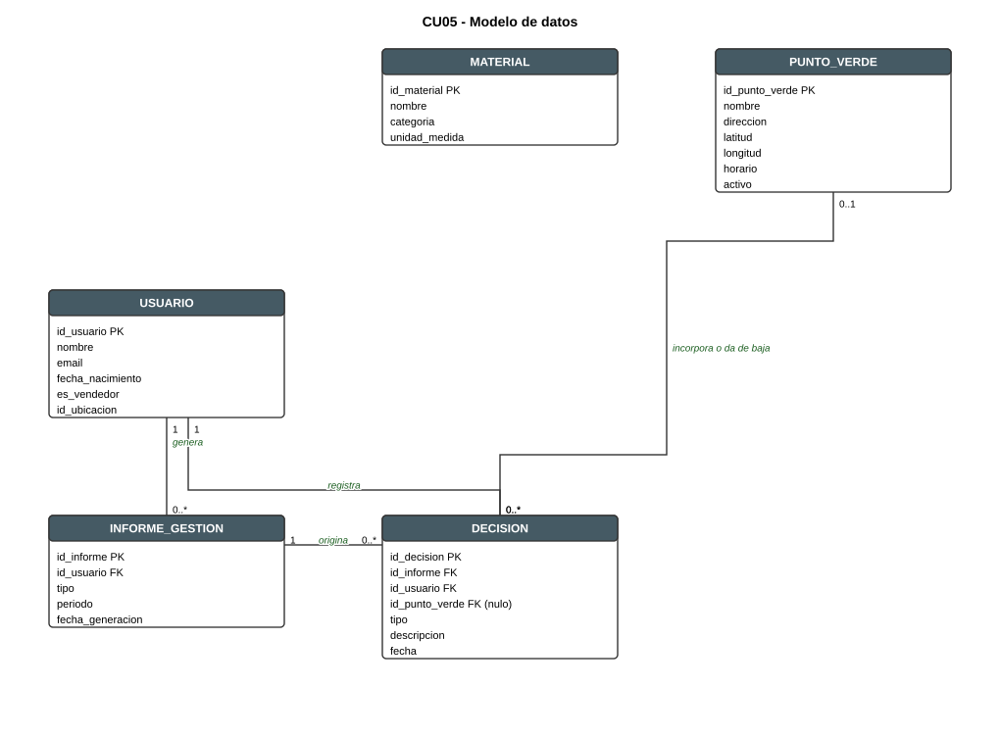
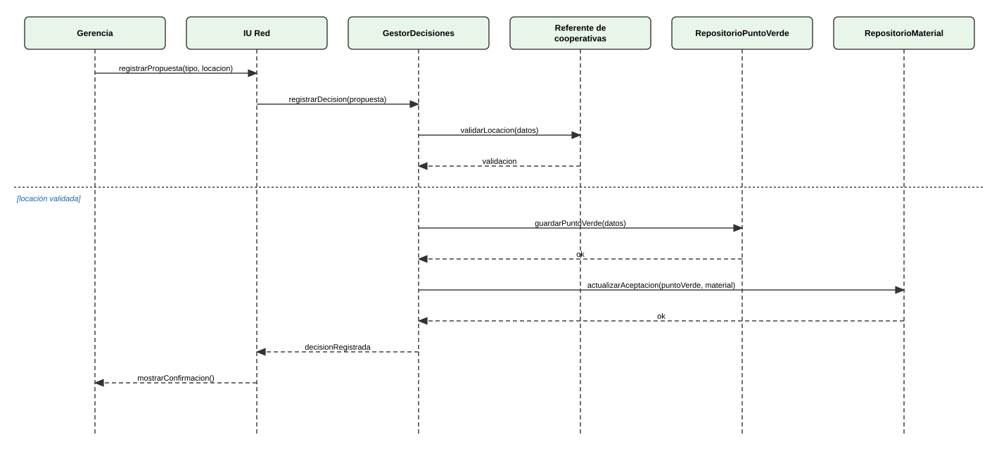

**CU06. Configurar comisiones y tabla de conversión de Eco-Puntos**

| Ítem | Detalle |
|---|---|
| Objetivo | Fijar las tarifas vigentes para la tienda y para la gamificación. |
| Actor principal | Gerencia. |
| Disparador | Decisión de cambio tarifario. |
| Precondiciones | Existe un informe del período que justifique el cambio. |
| Escenario principal | 1. La gerencia propone el nuevo porcentaje por categoría o la nueva tabla de conversión. 2. El sistema valida que los valores estén dentro de rango. 3. La gerencia confirma y define la vigencia. 4. El sistema guarda la tarifa. |
| Flujos alternativos | 2a. Valor fuera de rango: el sistema lo rechaza. |
| Postcondiciones | La nueva tarifa rige desde la fecha de vigencia. |

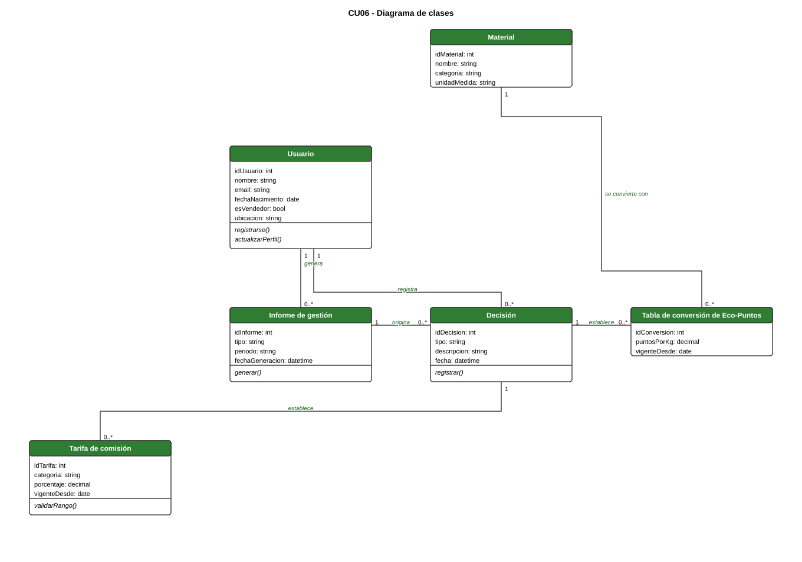
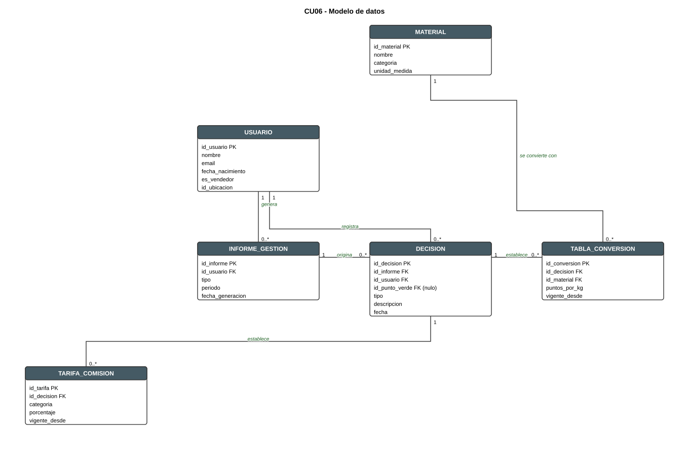
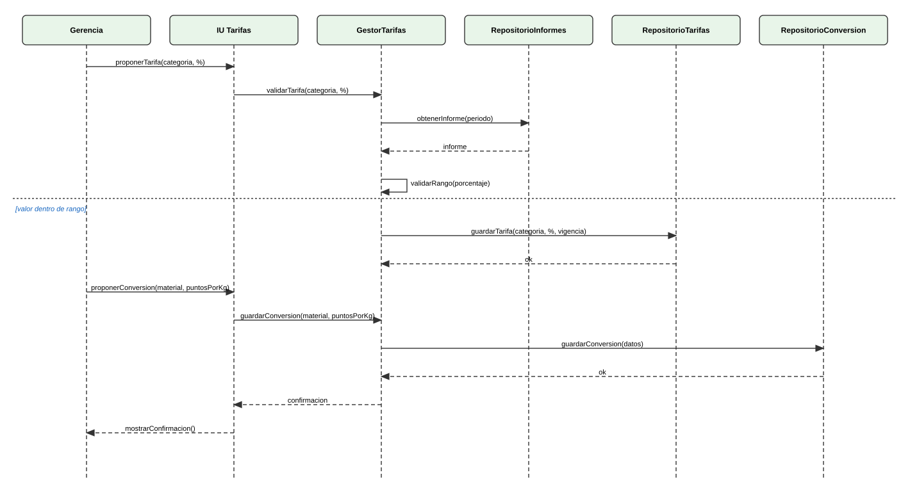

### 6. Diagrama de secuencia

Cada caso de uso tiene su secuencia (figuras de CU04, CU05 y CU06 arriba).

### 7. Modelo de datos del proceso

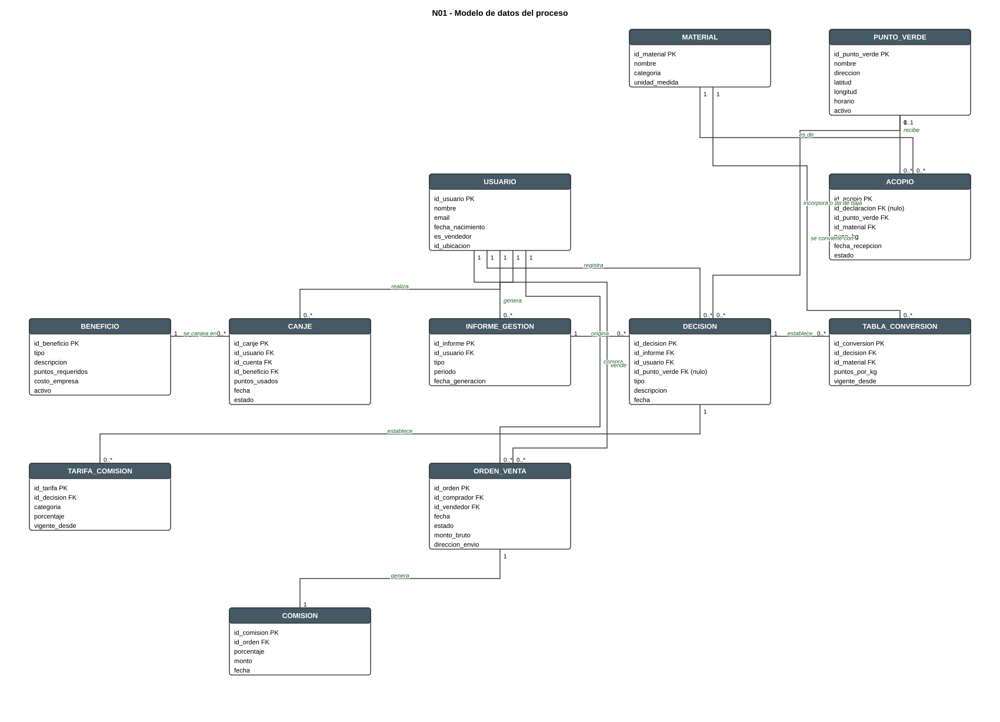

---

## N02. Venta de productos sustentables y cobro de comisión

**Naturaleza:** ingreso (monetización por intermediación).

### 1. Roles intervinientes

- **Vendedor sustentable:** publica productos, mantiene el stock y despacha los pedidos.
- **Comprador:** elige productos, paga y confirma la recepción.
- **Área comercial:** verifica publicaciones y vendedores, controla las ventas, retiene la comisión y libera el saldo neto.
- **Pasarela de pagos (externo):** procesa el cobro con tarjeta o transferencia.

### 2. Descripción funcional del proceso

- **Entrada:** producto publicado por el vendedor y pedido confirmado y pagado por el comprador.
- **Comportamiento:** el vendedor publica su producto. El área comercial verifica la publicación y la identidad del vendedor; si no está aprobada, el vendedor la corrige. El comprador paga el pedido a través de la pasarela. Si el cobro es aprobado, el área comercial registra la venta, retiene la comisión que corresponde a la categoría y registra el saldo neto del vendedor. El vendedor despacha el producto y el comprador confirma la recepción. Si la recepción es conforme, el área comercial libera el saldo neto y ordena la transferencia al vendedor. Si hay un reclamo, el comprador lo presenta, el saldo queda congelado y se audita.
- **Salida:** producto entregado, comisión ingresada a la empresa y saldo neto transferido al vendedor.

### 3. Diagrama de actividad

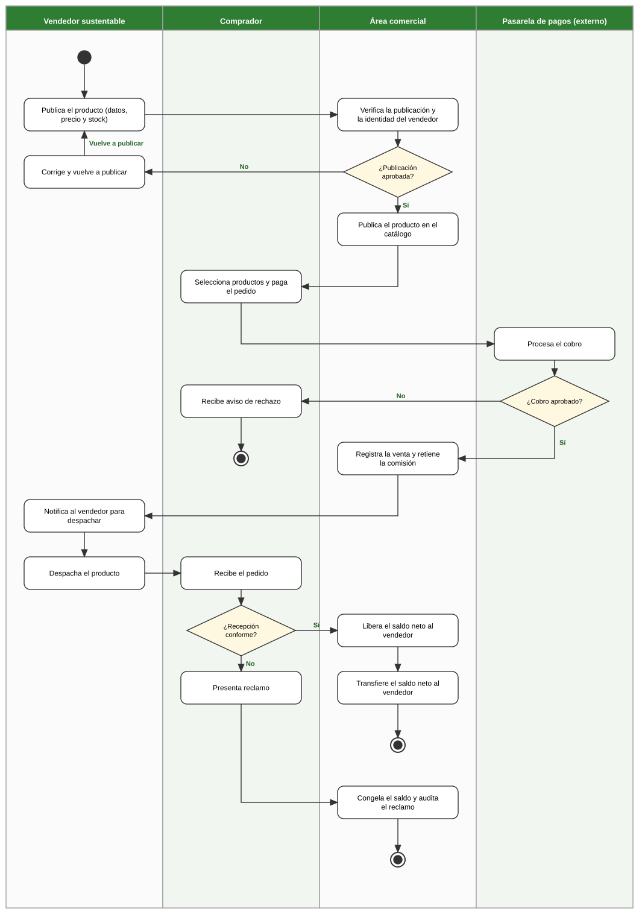

### 4. Modelo conceptual

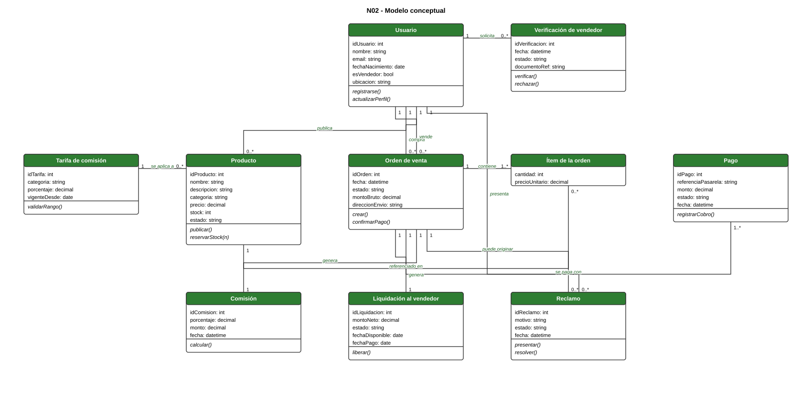

### 5. Especificación de casos de uso

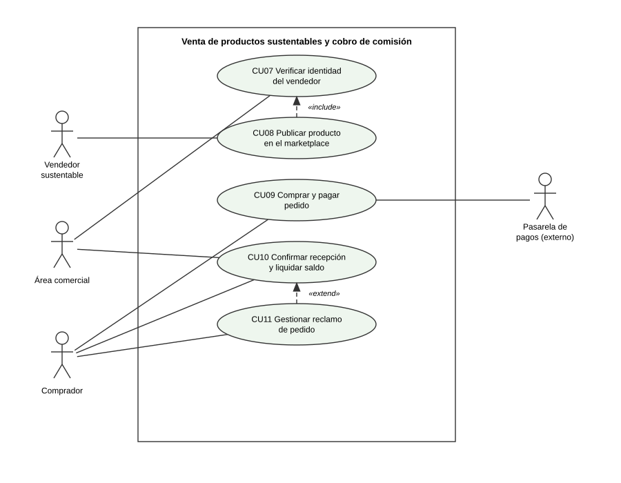

**CU07. Verificar identidad del vendedor**

| Ítem | Detalle |
|---|---|
| Objetivo | Confirmar que el vendedor es mayor de 18 años y que su registro es válido antes de que publique. |
| Actor principal | Área comercial. |
| Disparador | El vendedor solicita habilitarse para vender. |
| Precondiciones | El usuario está registrado. |
| Escenario principal | 1. El vendedor carga la declaración jurada de mayoría de edad y la documentación. 2. El área comercial revisa los datos. 3. El área comercial aprueba la verificación. 4. El sistema habilita al usuario como vendedor. |
| Flujos alternativos | 3a. Documentación incompleta o inválida: se rechaza y se notifica al usuario. |
| Postcondiciones | El usuario queda habilitado o rechazado como vendedor. |

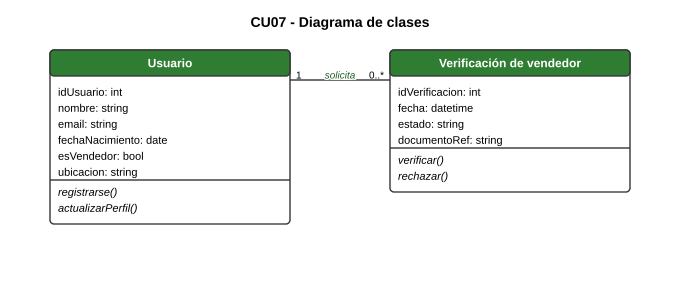
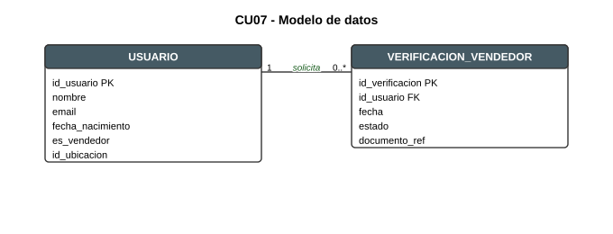
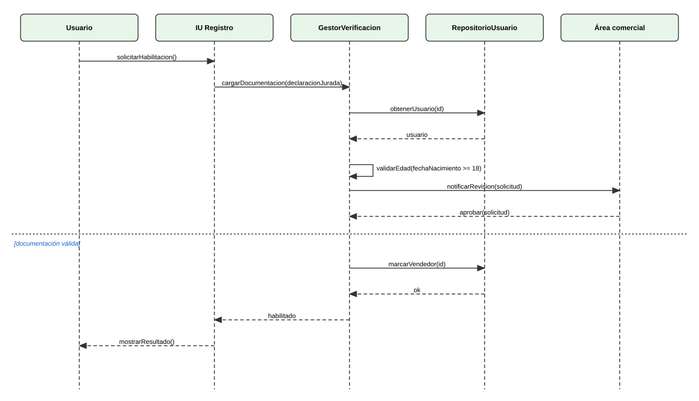

**CU08. Publicar producto en el marketplace**

| Ítem | Detalle |
|---|---|
| Objetivo | Que el vendedor ofrezca productos sustentables con precio, categoría y stock. |
| Actor principal | Vendedor sustentable. |
| Disparador | El vendedor elige crear una publicación. |
| Precondiciones | El vendedor está verificado (CU07). |
| Escenario principal | 1. El vendedor completa título, descripción, fotos, categoría, precio y stock. 2. El sistema muestra la comisión que se aplicará. 3. El vendedor acepta las condiciones y publica. 4. El área comercial aprueba la publicación. 5. El sistema la activa en el catálogo. |
| Flujos alternativos | 1a. Campos incompletos: no se publica. 4a. Publicación no aprobada: el vendedor la corrige y la vuelve a enviar. |
| Postcondiciones | El producto queda activo en el catálogo público. |

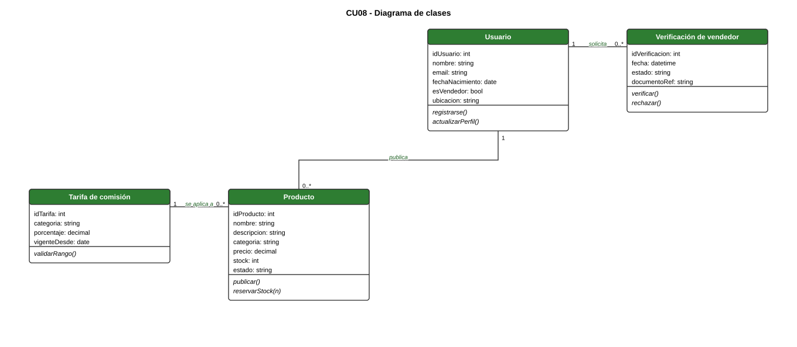
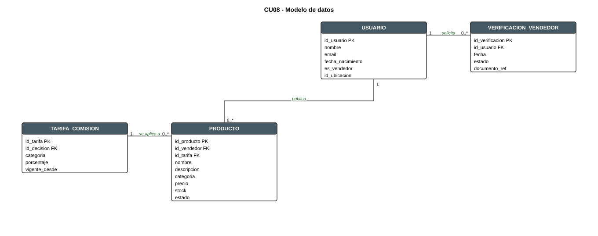
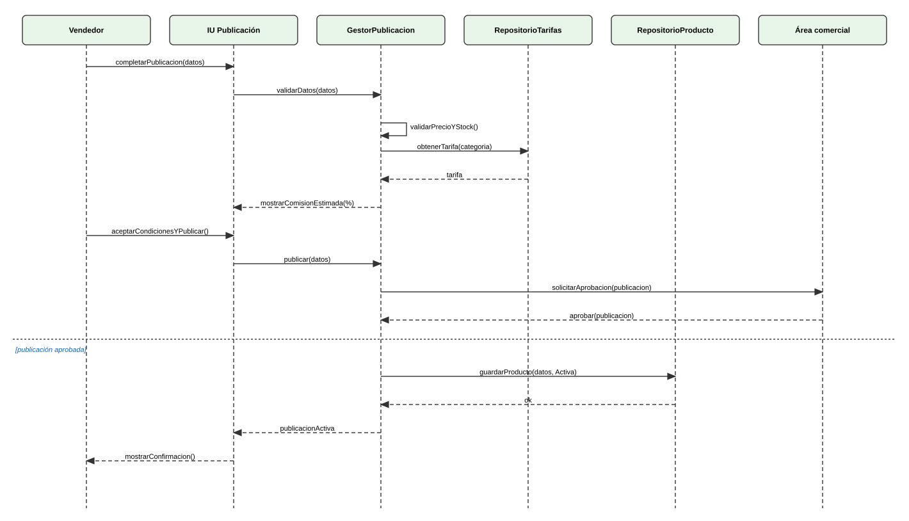

**CU09. Comprar y pagar pedido**

| Ítem | Detalle |
|---|---|
| Objetivo | Que el comprador abone el pedido mediante la pasarela de pagos. |
| Actores | Comprador, Pasarela de pagos (externo). |
| Disparador | El comprador confirma el pago del carrito. |
| Precondiciones | Existe stock en las publicaciones seleccionadas. |
| Escenario principal | 1. El comprador selecciona el domicilio de entrega y el medio de pago. 2. El sistema reserva el stock. 3. La pasarela procesa el cobro y devuelve el código de aprobación. 4. El sistema confirma la orden de venta, registra el pago y la comisión. |
| Flujos alternativos | 3a. Pago rechazado: el sistema libera el stock y notifica al comprador. |
| Postcondiciones | La orden queda en estado "Pagada, pendiente de despacho". |

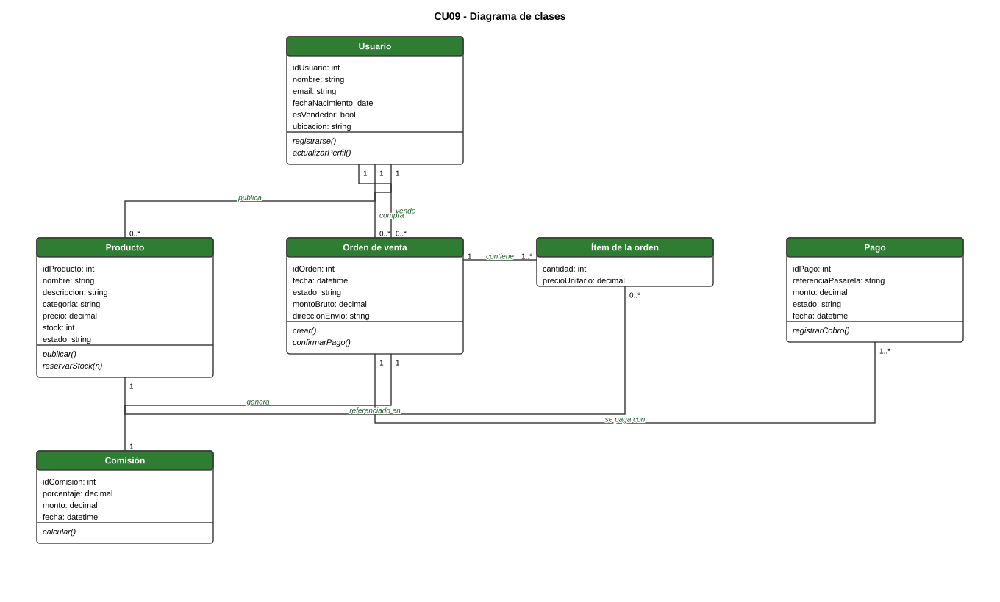
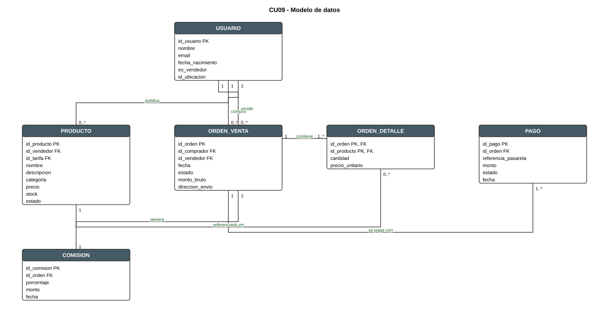
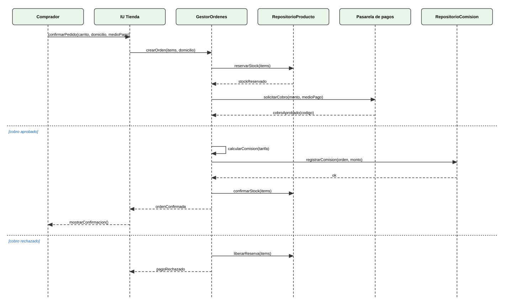

**CU10. Confirmar recepción y liquidar saldo al vendedor**

| Ítem | Detalle |
|---|---|
| Objetivo | Liberar el saldo neto al vendedor cuando el comprador recibe el producto conforme. |
| Actores | Comprador, Vendedor sustentable, Área comercial. |
| Disparador | El comprador confirma la recepción o vence el plazo de reclamo. |
| Precondiciones | La orden fue despachada por el vendedor. |
| Escenario principal | 1. El comprador confirma la recepción conforme. 2. El sistema marca el saldo neto como disponible. 3. El área comercial ordena la transferencia al vendedor. 4. El sistema registra la liquidación. |
| Flujos alternativos | 1a. Reclamo presentado: se ejecuta CU11. |
| Postcondiciones | La venta queda completa y el neto transferido al vendedor. |

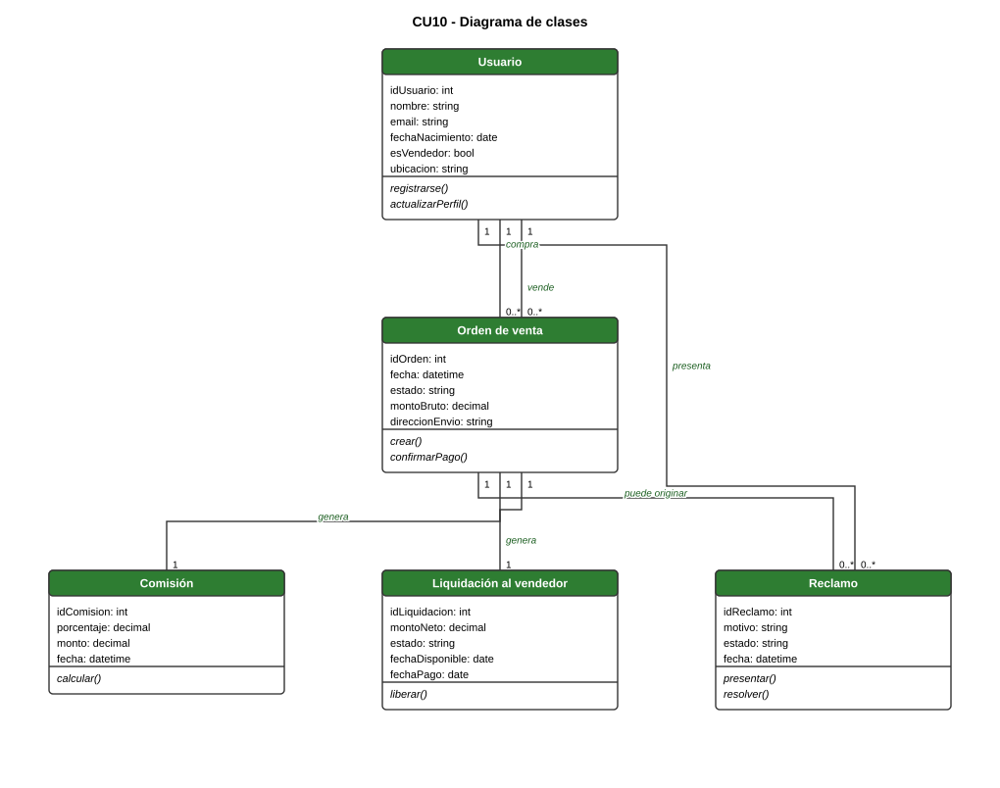
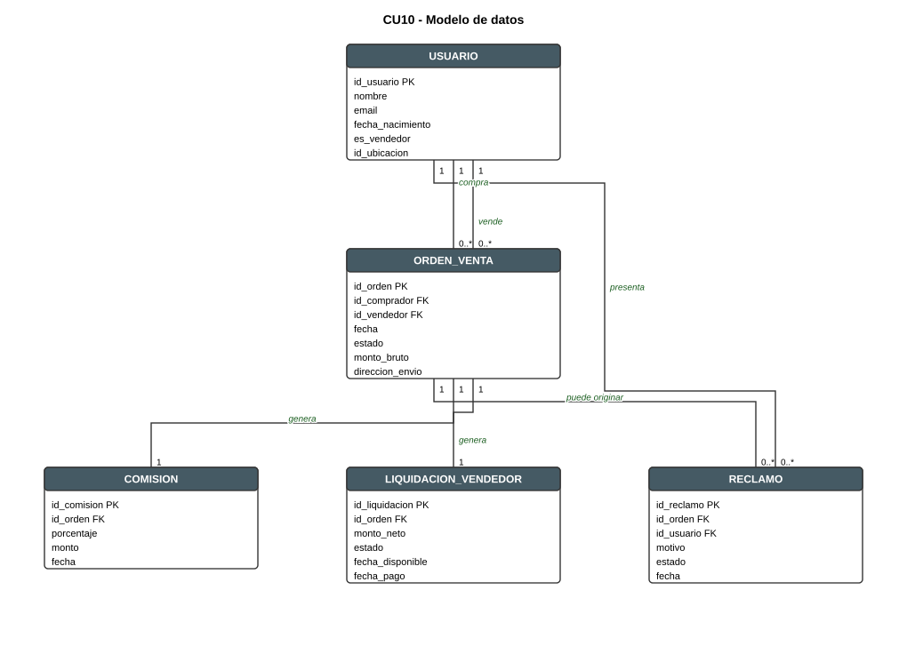
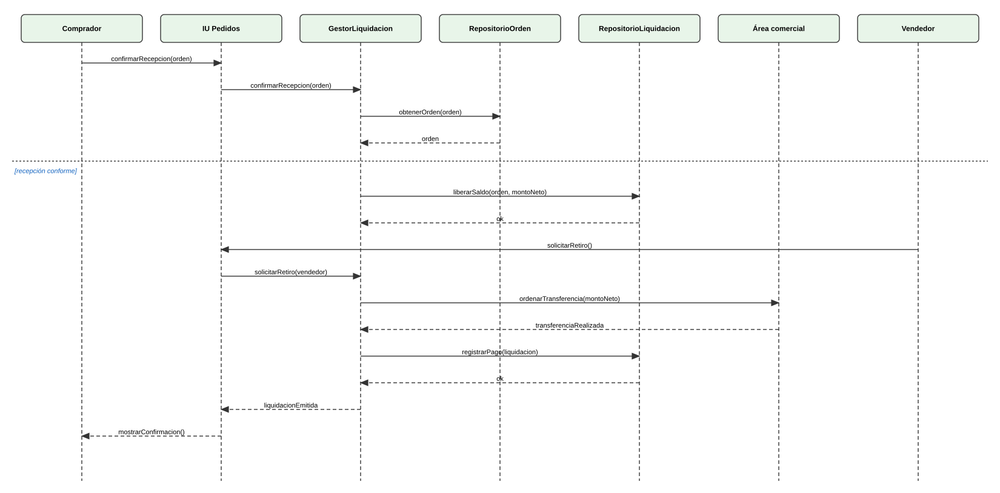

**CU11. Gestionar reclamo de pedido**

| Ítem | Detalle |
|---|---|
| Objetivo | Resolver un reclamo por producto dañado o no recibido sin liberar el saldo antes de tiempo. |
| Actores | Comprador, Área comercial. |
| Disparador | El comprador presenta un reclamo en lugar de confirmar la recepción. |
| Precondiciones | La orden fue despachada. |
| Escenario principal | 1. El comprador registra el motivo del reclamo. 2. El sistema congela el saldo neto. 3. El área comercial audita el reclamo. 4. El área comercial resuelve y libera o devuelve el saldo según corresponda. |
| Flujos alternativos | — |
| Postcondiciones | El reclamo queda cerrado y el saldo, resuelto. |

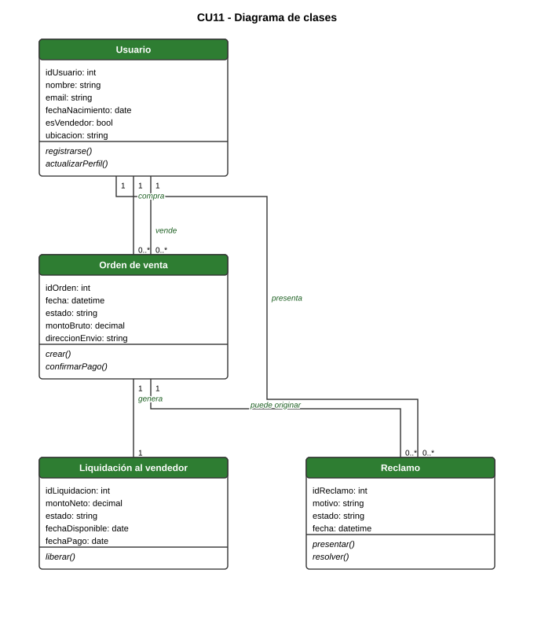
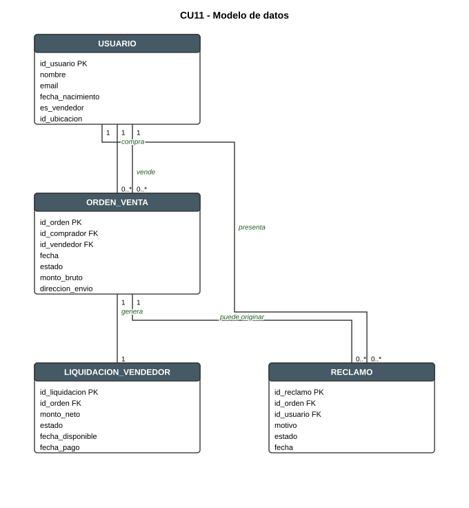
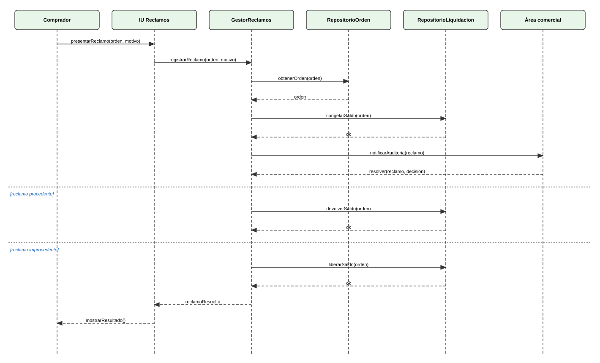

### 6. Diagrama de secuencia

Cada caso de uso tiene su secuencia (figuras de CU07 a CU11 arriba).

### 7. Modelo de datos del proceso

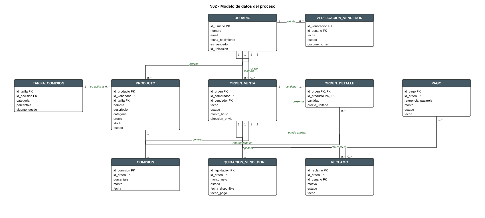

---

## N03. Reconocimiento por reciclaje y canje de Eco-Puntos

**Naturaleza:** egreso (costo que asume la empresa para incentivar el reciclaje).

### 1. Roles intervinientes

- **Ciudadano:** declara material, lo entrega o lo reutiliza, y canjea sus Eco-Puntos.
- **Operador de punto verde:** recibe el material, lo pesa y lo registra.
- **Área de administración:** acredita los Eco-Puntos y autoriza los canjes.

### 2. Descripción funcional del proceso

- **Entrada:** declaración de material del ciudadano y, si corresponde, entrega física en un punto verde; solicitud de canje de Eco-Puntos.
- **Comportamiento:** el ciudadano declara el material y recibe la recomendación: reutilizarlo en el hogar o entregarlo en un punto verde. Si reutiliza, confirma la acción y el área de administración acredita los Eco-Puntos. Si entrega, el operador recibe, pesa y registra el material, notifica el peso y el área de administración acredita los Eco-Puntos. Cuando el ciudadano pide un canje, el área de administración verifica el saldo: si alcanza, entrega el cupón o el envío bonificado y registra el costo; si no, informa la situación al ciudadano.
- **Salida:** Eco-Puntos acreditados, canjes entregados y costo registrado.

### 3. Diagrama de actividad

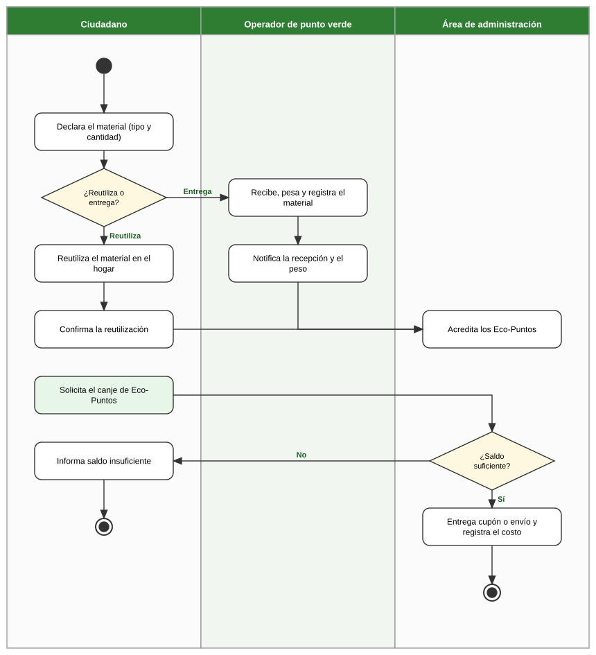

### 4. Modelo conceptual

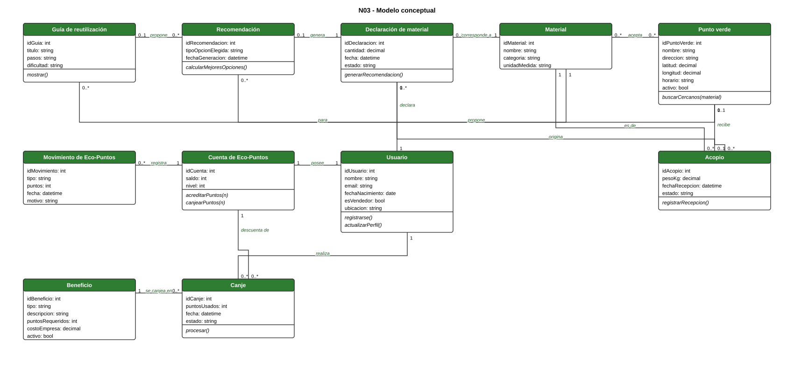

### 5. Especificación de casos de uso

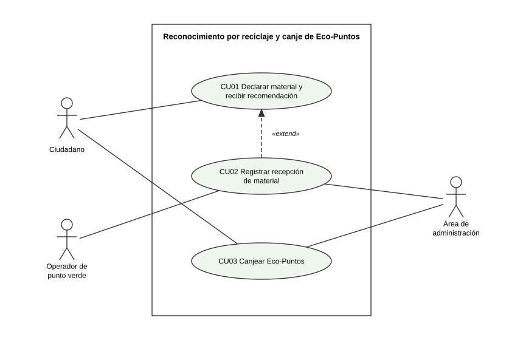

**CU01. Declarar material y recibir recomendación** (existente, reformulado)

| Ítem | Detalle |
|---|---|
| Objetivo | Que el ciudadano conozca la mejor forma de disponer de su material. |
| Actor principal | Ciudadano. |
| Actor secundario | Operador de punto verde (solo si elige entrega oficial, ver CU02). |
| Disparador | El ciudadano elige "Declarar material". |
| Precondiciones | El ciudadano está registrado y autenticado y tiene una ubicación cargada. |
| Escenario principal | 1. El ciudadano ingresa tipo y cantidad de material. 2. El sistema valida los datos. 3. El sistema cruza la ubicación con los puntos verdes y las guías disponibles para ese material. 4. El sistema presenta las dos mejores opciones: reutilizar o entregar. 5. El ciudadano elige reutilizar. 6. El sistema muestra la guía práctica. 7. El ciudadano confirma la reutilización. 8. El sistema acredita los Eco-Puntos. |
| Flujos alternativos | 2a. Datos inválidos: el sistema informa el error y finaliza. 5a. El ciudadano elige entrega oficial: el sistema muestra el punto verde más cercano y se extiende con CU02. |
| Postcondiciones | Queda registrada la recomendación con la opción elegida. Si el ciudadano confirmó, queda el movimiento de Eco-Puntos. |

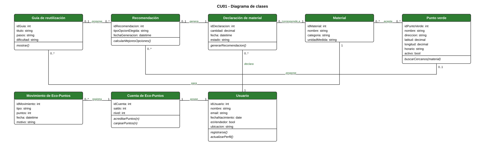
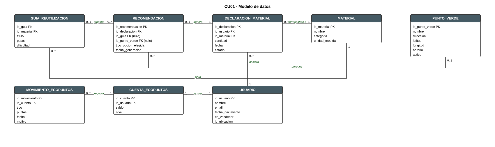
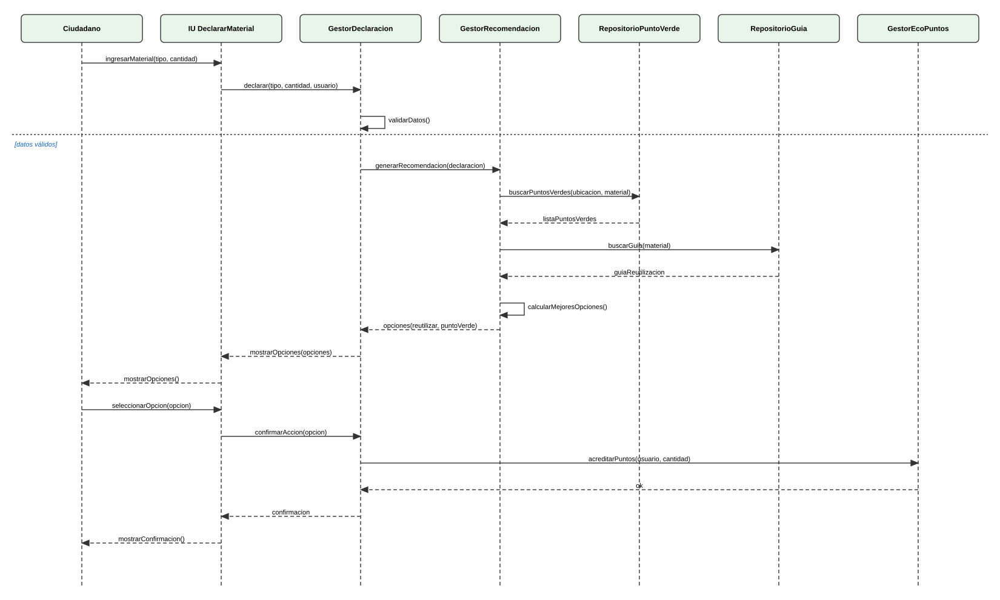

**CU02. Registrar recepción de material en punto verde** (extiende a CU01)

| Ítem | Detalle |
|---|---|
| Objetivo | Registrar físicamente el material entregado y acreditar los Eco-Puntos. |
| Actores | Operador de punto verde, Área de administración. |
| Disparador | El ciudadano llega al punto verde con el material. |
| Precondiciones | Existe una declaración con opción de entrega elegida (CU01). |
| Escenario principal | 1. El operador busca la declaración del ciudadano. 2. El operador registra el peso por material. 3. El sistema valida que el material esté aceptado en el punto verde y calcula los Eco-Puntos según la tabla vigente. 4. El operador confirma la recepción. 5. El área de administración acredita los Eco-Puntos. |
| Flujos alternativos | 3a. Material no aceptado o contaminado: el operador rechaza la carga y se cancela. 3b. Límite diario excedido: se procesa hasta el tope. |
| Postcondiciones | El acopio queda registrado y los Eco-Puntos acreditados. |

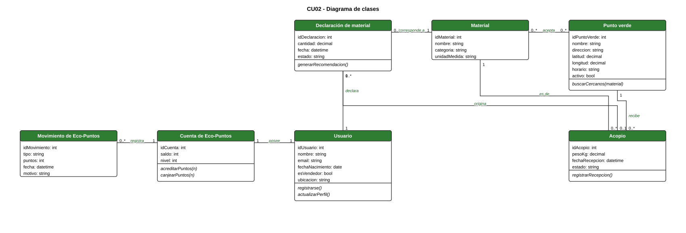
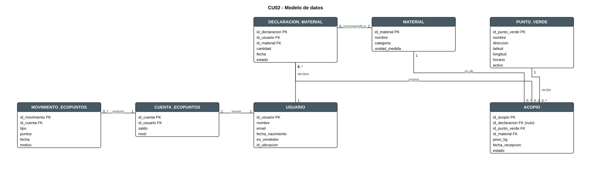
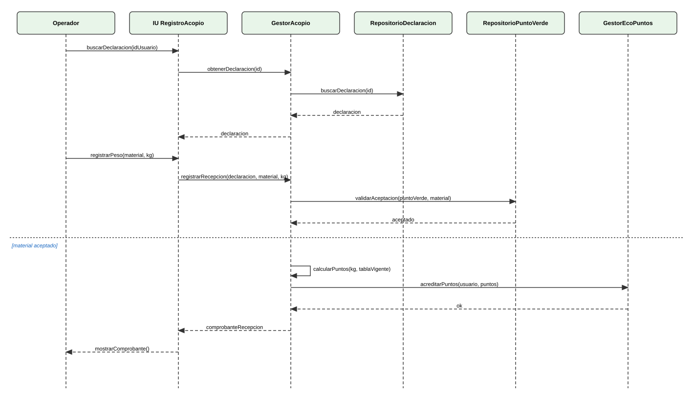

**CU03. Canjear Eco-Puntos por cupón o envío bonificado**

| Ítem | Detalle |
|---|---|
| Objetivo | Que el ciudadano convierta sus Eco-Puntos en beneficios. |
| Actores | Ciudadano, Área de administración. |
| Disparador | El ciudadano elige "Canjear". |
| Precondiciones | El ciudadano tiene saldo de Eco-Puntos. |
| Escenario principal | 1. El ciudadano consulta su saldo y los beneficios disponibles. 2. Elige un beneficio. 3. El sistema verifica el saldo y descuenta los puntos. 4. El sistema genera el cupón o el envío bonificado y registra el costo. |
| Flujos alternativos | 3a. Saldo insuficiente: el sistema informa y no realiza el canje. |
| Postcondiciones | Los puntos quedan descontados y el beneficio entregado. |

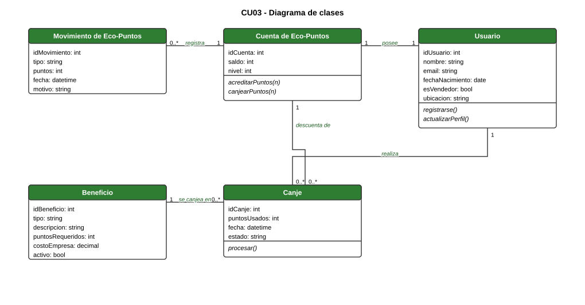
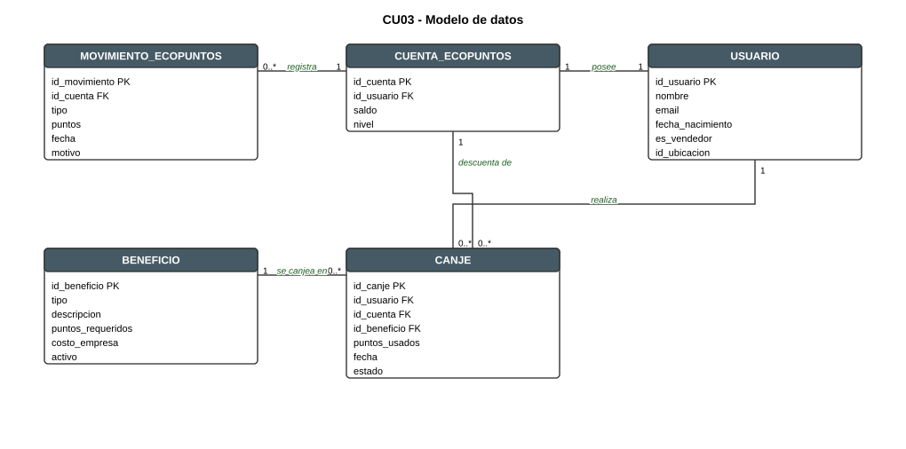
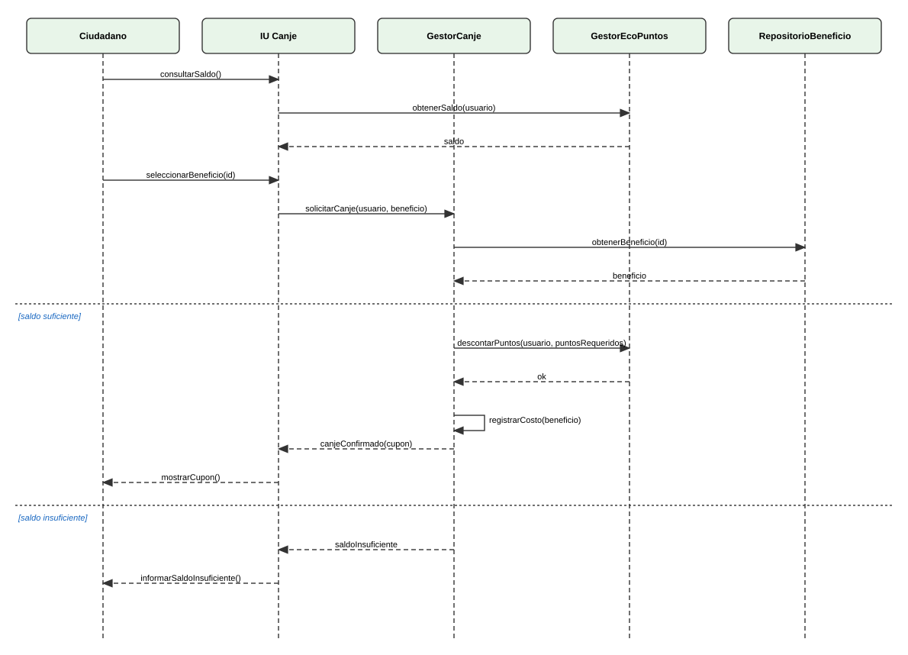

### 6. Diagrama de secuencia

Cada caso de uso tiene su secuencia (figuras de CU01 a CU03 arriba).

### 7. Modelo de datos del proceso

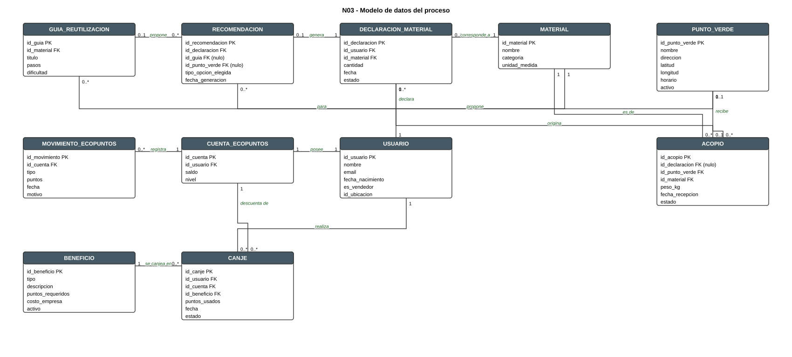

---

## Notas sobre los diagramas

- La relación **INFORME – ACOPIO ("resume")** aparece en el diagrama de clases, pero no en el DER, porque el modelo relacional no tiene una clave que la represente. Si se quiere en el DER, habría que agregar una clave en ACOPIO o una tabla intermedia.
- La relación **PUNTO VERDE – MATERIAL ("acepta")** es de muchos a muchos. En el diagrama de clases se dibuja directa; en el DER se resuelve con la entidad asociativa PUNTO_VERDE_MATERIAL.
- Los diagramas de secuencia de cada caso de uso muestran los escenarios principales y las alternativas como condiciones [entre corchetes]. Los flujos alternativos completos están en las tablas.

## Pendientes

- Confirmar con la cátedra la numeración: el N01 de la primera entrega pasa a ser CU01 dentro de N03.
- Confirmar si el reconocimiento de Eco-Puntos se considera egreso (es un costo que asume la empresa).
- Revisar la vista de cada figura antes de pegarla en el documento final.
